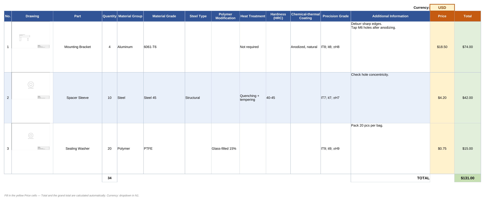

# Parts Table Builder

Собирает готовую Excel-таблицу деталей для производства: парсит текстовое
описание характеристик, подставляет превью чертежей из PDF и раскладывает
всё в аккуратный `.xlsx` с ценами и итогами — из простого `Details.txt` и
папки с чертежами.


<sub>Таблица выше сгенерирована из данных в <code>demo/</code> этим же скриптом — команда указана ниже.</sub>

## Зачем это нужно

Типичный сценарий: вы собираете техническое задание для стороннего
производства (в том числе зарубежного). Характеристики деталей описаны в
одном текстовом файле на двух языках, чертежи лежат россыпью PDF-файлов, а
на выходе нужна одна понятная таблица на английском — с миниатюрами
чертежей, ценами и суммой заказа. Делать это руками на каждый заказ долго
и легко ошибиться в номерах деталей. Скрипт делает это за секунды.

## Возможности

- Парсит `Details.txt` с блоками `[RU]` и `[EN]` — берёт данные из `[EN]`,
  а `[RU]`-блок использует только как запасной способ сопоставить деталь с
  чертежом по названию.
- Поддерживает многострочные поля (например, «Дополнительная информация» —
  списки, абзацы, перенос строк).
- Автоматически скрывает колонки, которые пустые сразу у всех деталей
  (нет смысла показывать «Термообработка», если в заказе только полимерные
  детали) — при этом «Part», «Quantity», «Material Group» и
  «Material Grade» показываются всегда.
- Подставляет превью первой страницы каждого PDF-чертежа прямо в ячейку
  таблицы (через `pdftoppm`), с автообрезкой белых полей.
- Сопоставляет чертёж с деталью по номеру в начале имени файла
  (`3. Вал.pdf` → деталь №3), а если номера нет — по названию детали из
  `[RU]`-блока.
- Готовая колонка «Price» с выпадающим списком валют и защитой от ввода
  цены текстом; «Total» и общая сумма считаются формулами.
- Работает как обычный CLI-скрипт **и** как HTTP-микросервис (Flask) —
  удобно дёргать из n8n, Zapier, Make или любого другого no-code-инструмента.

## Формат `Details.txt`

```text
[RU]
1. Деталь: Вал
   - Количество: 1
   - Группа материала: Сталь
   - Марка материала: AISI 316L
   ...

[EN]
1. Part: Shaft
   - Quantity: 1
   - Material Group: Steel
   - Material Grade: AISI 316L
   - Additional Information: Deburr sharp edges.
   Chamfer both ends 1x45°.
```

Правила простые:
- строка поля — это дефис **и пробел**: `- Ключ: значение`;
- любая следующая строка без такого дефиса считается продолжением
  предыдущего поля (перенос строки сохраняется);
- пустая строка внутри поля — это разрыв абзаца, а не конец поля;
- реальные данные для таблицы скрипт берёт только из блока `[EN]`.

Список поддерживаемых колонок и их порядок — в `PARAM_COLUMNS` в начале
`build_parts_table.py`.

## Быстрый старт

### Вариант 1 — локально, как обычный скрипт

Понадобится Python 3.10+ и системная утилита `poppler-utils` (даёт
`pdftoppm` для рендера чертежей).

```bash
# Ubuntu/Debian
sudo apt-get install poppler-utils

pip install -r requirements.txt

python3 build_parts_table.py \
  --details demo/Details.txt \
  --pdf-dir demo/drawings \
  --out Parts_table_EN.xlsx \
  --currency USD
```

Ключи:

| Ключ | По умолчанию | Описание |
|---|---|---|
| `--details` | `Details.txt` | путь к текстовому файлу с характеристиками |
| `--pdf-dir` | `.` | папка с PDF-чертежами |
| `--out` | `Parts_table_EN.xlsx` | путь для результата |
| `--dpi` | `150` | разрешение рендера превью чертежей |
| `--currency` | `USD` | валюта по умолчанию (`USD` или `CNY`, см. ниже) |
| `--keep-all-columns` | выкл. | не скрывать пустые колонки |

### Вариант 2 — как HTTP-сервис в Docker

Так проще всего подключить сборку таблицы к любому no-code/low-code
инструменту (n8n, Make, Zapier, свой бэкенд) — сервис принимает файлы по
HTTP и отдаёт готовый `.xlsx`.

```bash
docker build -t parts-builder .
docker run -d --name parts-builder -p 8000:8000 parts-builder
```

```bash
curl http://localhost:8000/health

curl -X POST http://localhost:8000/reset

curl -X POST http://localhost:8000/upload \
  -F "file=@demo/Details.txt"
curl -X POST http://localhost:8000/upload \
  -F "file=@demo/drawings/1. Mounting Bracket.pdf"

curl -X POST "http://localhost:8000/build?currency=USD" \
  -o Parts_table_EN.xlsx
```

Если ваш n8n запущен на Docker Hardened Image (без `apk`/`apt`/`bash`
внутри) и вам нужно поднять этот сервис рядом с ним без открытия порта
наружу — смотрите подробную инструкцию: [`docs/n8n-hardened-image-setup.md`](docs/n8n-hardened-image-setup.md).

## API

| Метод | Путь | Тело | Ответ |
|---|---|---|---|
| `GET` | `/health` | — | `{status, poppler, currencies}` |
| `POST` | `/reset` | — | очищает рабочую папку |
| `POST` | `/upload` | `multipart/form-data`: `file`, опц. `filename` | `{status, saved, files}` |
| `POST` | `/build?currency=USD` | — (использует загруженные ранее файлы) | готовый `.xlsx` файлом; заголовки `X-Parts-Count`, `X-Unmatched`, `X-Currency` |
| `POST` | `/zip` | JSON `{name, files: [{path, content: base64}]}` | готовый `.zip` файлом |

Сервис хранит состояние между вызовами в `/work` внутри контейнера — сначала
`/reset`, затем один или несколько `/upload`, затем `/build`. Максимальный
размер одного файла — 200 МБ (см. `MAX_CONTENT_LENGTH` в `app.py`).

## Демо

В папке [`demo/`](demo/) лежит полностью вымышленный пример — три
несуществующие детали и сгенерированные заглушки чертежей (никаких
реальных заказов или данных клиентов). Именно из него собрана таблица на
скриншоте выше:

```bash
python3 build_parts_table.py \
  --details demo/Details.txt --pdf-dir demo/drawings \
  --out demo_result.xlsx --currency USD
```

## Валюты

Из коробки поддержаны `USD` и `CNY` (см. словарь `CURRENCIES` в
`build_parts_table.py` — там же и формат отображения цены). Чтобы добавить
свою валюту, достаточно дописать в этот словарь код валюты и Excel-формат
числа, например:

```python
CURRENCIES = {
    "USD": '"$"#,##0.00',
    "CNY": '"\u00a5"#,##0.00',
    "EUR": '"\u20ac"#,##0.00',
}
```

## Структура проекта

```
.
├── app.py                      # Flask-обёртка (HTTP API)
├── build_parts_table.py        # основная логика сборки таблицы
├── Dockerfile
├── requirements.txt
├── demo/                       # вымышленный пример входных данных
│   ├── Details.txt
│   └── drawings/*.pdf
└── docs/
    ├── preview.png
    └── n8n-hardened-image-setup.md
```

## Известные ограничения

- В таблицу вставляется только первая страница PDF-чертежа.
- Сопоставление чертежа с деталью работает по номеру в начале имени файла
  (`N. Название.pdf`); при отсутствии номера — по названию детали из
  `[RU]`-блока (с нормализацией регистра и пробелов).
- Формулы `Total`/сумма используют жёстко заданные адреса ячеек, поэтому
  ручная перестановка строк/столбцов в готовом `.xlsx` их сломает.

## Лицензия

[MIT](LICENSE) — используйте и меняйте свободно.
